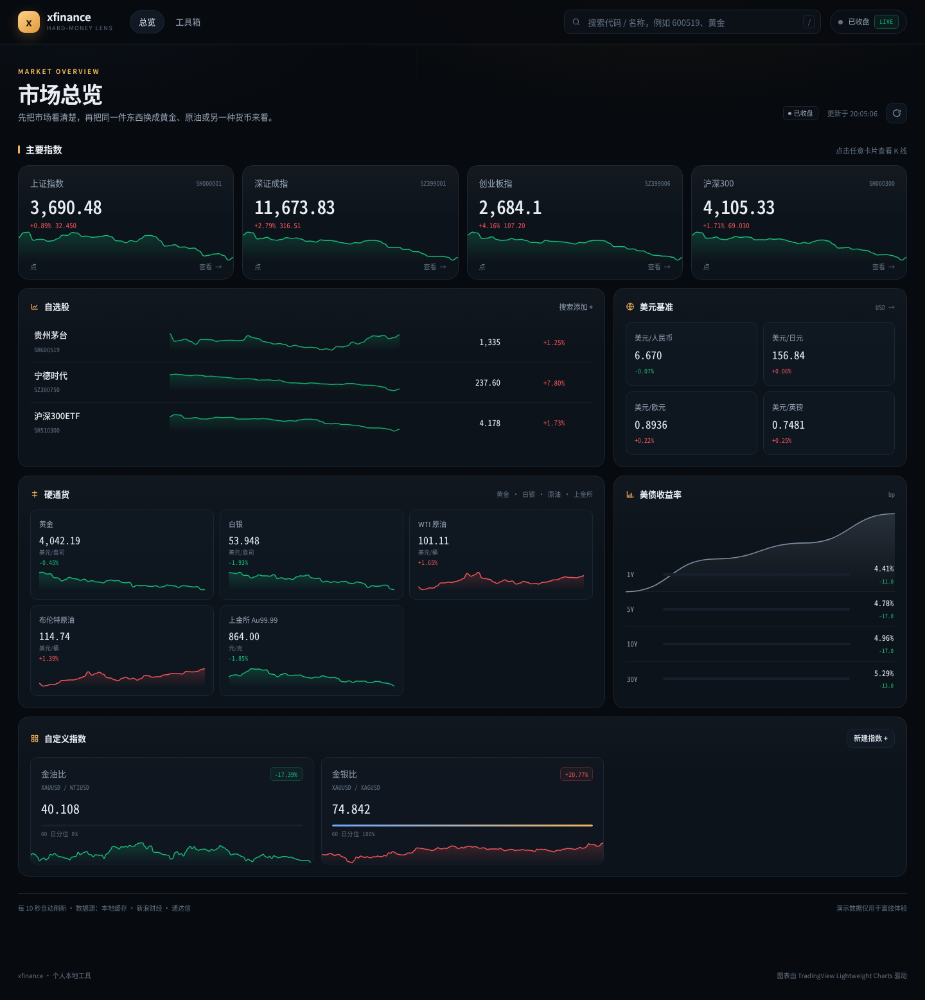
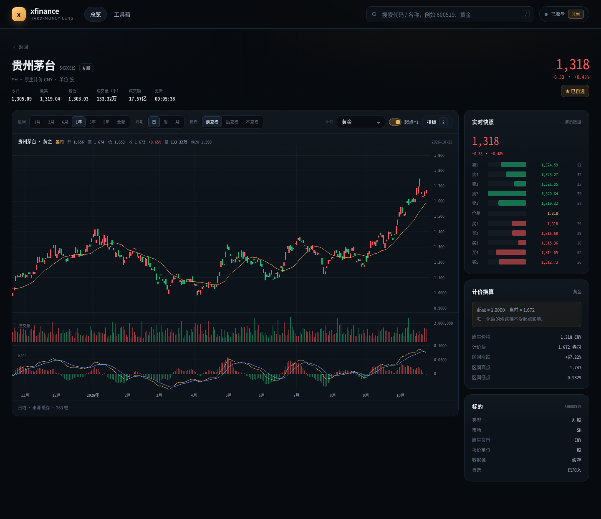

# xfinance

个人股票查看器。同一只股票，可以换成人民币、美元、日元看，也可以换成多少盎司黄金、多少克上金所金、多少桶 WTI 或布伦特来看。

FastAPI + Vue 3 + lightweight-charts。uv 管理后端依赖，SQLite 本地缓存，一条命令启动开发环境。



## 功能

- **行情总览**：主要指数、自选股、美元基准汇率、黄金 / 白银 / WTI / 布伦特 / 上金所金、美债 1 至 30 年期收益率。每 10 秒刷新，卡片点击进入 K 线。
- **股票查看**：A 股、ETF、LOF、指数搜索。实时快照与五档盘口，日 / 周 / 月 K 线，前复权 / 后复权 / 不复权。
- **计价切换**：人民币、美元、日元、欧元、英镑、黄金（美元/盎司）、上金所金（人民币/克）、白银、WTI、布伦特。支持起点归一化。切换标的时默认跟随标的原生货币，找不到对应计价物时回到人民币，工具栏提供一键重置。
- **技术指标**：主图 MA / BOLL，副图成交量、MACD，可选 RSI / KDJ。偏好保存在浏览器本地。
- **自定义指数**：安全的四则运算表达式，例如 `XAUUSD / WTIUSD`。支持 `@名称` 引用已有指数，显示滚动分位。价格序列先折算成美元，避免单位混用。
- **金融工具**：定投回测、相关性矩阵、复利计算器。全部走同一套服务端计价函数。
- **数据健壮性**：真实数据优先，按板块失败回退到演示数据，并在界面标注来源。测试全部离线。



## 快速开始

需要 Python 3.12+、[uv](https://docs.astral.sh/uv/)、Node 20.19+ 或 22.12+。

```bash
uv sync

# 一条命令同时启动 FastAPI 和 Vite
uv run python scripts/devserver.py
```

打开 `http://127.0.0.1:5173`。`/api` 由 Vite 代理到 `http://127.0.0.1:8000`，浏览器只看到一个源。

想先不连外网：

```bash
uv run python scripts/devserver.py --data-mode demo
```

### 只跑后端

```bash
uv run python -m app --port 8000
# 或
uv run xfinance-app
```

如果没有 `app/frontend-build`，根路径会显示一段启动说明，API 仍可用，文档在 `/docs`。

### 生产构建

```bash
cd frontend
npm install
npm run build
cd ..
uv run xfinance-app
```

构建产物写入 `app/frontend-build`，FastAPI 直接托管，SPA 深链接会回退到 `index.html`。

### 打包成 wheel

```bash
uv build
uv tool install dist/xfinance-0.1.0-py3-none-any.whl
xfinance-app
```

Hatch 构建钩子会先构建前端再打 wheel，静态资源随包分发。

## 计价模型

一条纯函数把任何价格换算成任何计价物：

```
asset_usd  = price_in_asset_currency * fx(asset_currency -> USD)
quoted     = asset_usd / numeraire_value_usd
normalized = quoted / quoted[window_start]
```

`numeraire_value_usd` 只由注册表决定。USD 为 1；CNY / JPY / EUR 取 `1 / USDXXX`；黄金取 `XAUUSD`；上金所金取 `AU9999 / USDCNY`；原油取 `WTIUSD` 或 `BRENTUSD`。

汇率、商品、美债都按日期对齐并向前填充。缺少某段计价序列时跳过该日期，而不是编造价格。

## 数据源

| 数据 | 主源 | 回退 |
| --- | --- | --- |
| A 股 / ETF / 指数 K 线、快照 | eltdx（通达信 7709，服务端复权） | 演示序列 |
| 证券代码表 | eltdx 代码表，12 小时缓存 | 内置目录 |
| 汇率日线 | Frankfurter（ECB） | 演示序列 |
| 黄金 / 白银 / WTI / 布伦特日线 | 新浪外盘期货 | 演示序列 |
| 商品实时快照 | 新浪 `hf_*` | 日线最后两根 |
| 上金所 Au99.99 日线 | 上金所官方 | 新浪快照 / 演示 |
| 美债收益率 | 美国财政部 CSV | 演示序列 |

`XFINANCE_DATA_MODE=auto|live|demo`。`auto` 先请求真实源，失败时按板块回退，响应里的 `meta.source` 和界面上的数据源标签会写明来源。`live` 不允许回退，`demo` 不访问外网。

## 项目结构

```
.
├── frontend/                   Vue 3 + Vite
│   ├── src/
│   │   ├── views/              总览、标的、自定义指数、工具箱
│   │   ├── components/         图表、搜索、弹窗、迷你走势
│   │   └── composables/        轮询偏好、提示
│   ├── vite-plugin-fastapi.js  开发时把 /api 代理到 FastAPI
│   └── package.json
├── app/                        Python 包
│   ├── __main__.py             CLI 入口，内嵌 uvicorn
│   ├── app.py                  应用装配、静态资源、异常处理
│   ├── api/                    HTTP 边界
│   ├── services/               用例编排
│   ├── domain/                 纯函数：计价、指标、DSL、统计
│   ├── repositories/           SQLAlchemy 仓储与 Alembic 迁移
│   ├── infrastructure/         外部数据源、缓存
│   └── frontend-build/         Vue 构建产物，随 wheel 分发
├── scripts/
│   ├── devserver.py            同时启动 Vite 与 FastAPI
│   └── fastapi-vue/
│       ├── buildhook.py        Hatch 构建钩子
│       ├── buildutil.py        前端构建
│       └── devutil.py          子进程与健康检查
├── tests/                      离线测试
├── alembic.ini
├── pyproject.toml
└── PLAN.md
```

分层方向是 `api -> services -> domain <- repositories`。`domain` 不依赖 FastAPI、SQLAlchemy 或 httpx，因此计价、指标、表达式、回测都可以脱离框架测试。

## 配置

pydantic-settings 读取环境变量和 `.env`，前缀 `XFINANCE_`。

| 变量 | 默认 | 说明 |
| --- | --- | --- |
| `XFINANCE_DATA_DIR` | `~/.xfinance` | SQLite 与数据目录 |
| `XFINANCE_DATABASE_URL` | `sqlite+pysqlite:///{data_dir}/xfinance.db` | 覆盖数据库地址 |
| `XFINANCE_DATA_MODE` | `auto` | `auto` / `live` / `demo` |
| `XFINANCE_HOST` | `127.0.0.1` | 监听地址 |
| `XFINANCE_PORT` | `8000` | 监听端口 |
| `XFINANCE_UPSTREAM_TIMEOUT` | `8` | 外部请求超时秒数 |
| `XFINANCE_SNAPSHOT_TTL` | `5` | 股票快照缓存秒数 |
| `XFINANCE_DEMO_AS_OF` | 今天 | 演示数据截止日，测试用 |
| `XFINANCE_FRONTEND_BUILD` | 包内 `frontend-build` | 静态资源目录 |
| `XFINANCE_LOG_LEVEL` | `INFO` | 日志级别 |

命令行参数覆盖对应配置：

```bash
uv run python -m app --host 0.0.0.0 --port 9000 \
  --data-mode demo --data-dir ./data --no-browser
```

## API

所有 JSON 响应形如 `{"data": ..., "meta": {"source": ..., "generated_at": ...}}`，错误形如 `{"error": {"code": ..., "message": ...}}`。

| 方法 | 路径 | 说明 |
| --- | --- | --- |
| GET | `/api/overview` | 总览卡片、市场状态、数据源 |
| GET | `/api/search?q=` | 代码或名称搜索 |
| GET | `/api/instruments/{symbol}` | 标的元信息 |
| GET | `/api/instruments/{symbol}/snapshot` | 快照与五档 |
| GET | `/api/instruments/{symbol}/chart` | K 线、指标、计价、归一化 |
| GET | `/api/watchlist` | 自选股列表 |
| POST/DELETE | `/api/watchlist/{symbol}` | 加入 / 移出自选 |
| GET | `/api/custom-indices` | 自定义指数列表 |
| POST | `/api/custom-indices` | 新建自定义指数 |
| DELETE | `/api/custom-indices/{id}` | 删除自定义指数 |
| POST | `/api/custom-indices/validate` | 表达式校验 |
| GET | `/api/custom-indices/{id}/chart` | 表达式图表与分位 |
| GET | `/api/tools/dca` | 定投回测 |
| GET | `/api/tools/correlation` | 相关性矩阵 |
| POST | `/api/tools/compound` | 复利计算 |

图表参数：`timeframe=1d|1w|1m`、`adjust=none|qfq|hfq`、`numeraire=CNY|USD|XAU|XAU_CNY_G|WTI|...`、`normalize=true|false`、`range=1m|3m|6m|1y|3y|5y|max`、`indicators=ma:20,ma:60,boll:20,macd,rsi:14,kdj`。

示例：

```bash
curl 'http://127.0.0.1:8000/api/instruments/SH600519/chart?numeraire=XAU&range=1y&normalize=true'
```

## 测试

```bash
uv run pytest
```

83 个用例全部离线运行：计价换算、指标、表达式 DSL、统计与回测、降采样、API 生命周期、自选股、自定义指数、工具接口、时间戳与错误响应、外部数据源解析。测试固定 `demo_as_of`，不访问通达信、ECB 或新浪。

## 开发工具

- `frontend/vite-plugin-fastapi.js`：把 `/api` 代理到 `FASTAPI_URL`，默认 `http://127.0.0.1:8000`。
- `scripts/devserver.py`：安装前端依赖、启动两个进程、等待健康检查、退出时清理子进程。`--build-only` 只构建前端。
- `scripts/fastapi-vue/buildhook.py`：Hatch 自定义构建钩子，在 wheel 构建前运行 Vite 并把 `app/frontend-build/**` 加入产物。
- `alembic.ini`：`uv run alembic upgrade head` 可用。运行时也会自动执行同一套迁移。

## 边界

- 行情以 A 股、ETF、LOF、指数为主，不包含港股、美股。
- eltdx 使用非商业研究许可，使用前请阅读其许可与免责声明。
- 市场状态只按工作日和 A 股交易时段判断，不识别中国法定节假日。
- 自定义指数只支持数字、序列引用、`@名称`、四则运算、乘方和 `abs/min/max`，不做任意代码执行。
- SQLite 适合个人单机查看，不面向多用户并发写入。
- 演示数据是确定性的合成序列，只用于离线体验和测试，不代表任何真实行情。

## 许可

代码以 MIT 许可发布。第三方组件与数据源许可见 [THIRD_PARTY_NOTICES.md](THIRD_PARTY_NOTICES.md)。界面页脚保留 TradingView Lightweight Charts 的署名链接。
